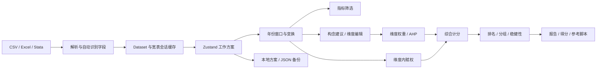

# 衡策 Hengce 项目系统复审报告

复审日期：2026-10-08。对象：用户提供的 `grok-workspace.zip`。本次只做阅读、评估与验证，未修改原有业务源码。新增文件位于 `audit/`；依赖安装、重新构建和浏览器运行会产生运行文件。

## 1. 总体判断

项目已经形成可操作的分析工作台，五步流程清楚，示例数据、指标字典、维度编辑、赋权、排名、报告与方案备份相互连接。界面风格一致，桌面与手机上的基本流程能运行。**目前适合演示、教学和探索性分析；在修复下述数据与算法问题、建立方法基准前，不宜把它产生的排名、自动构念或区间直接当作正式研究或决策结果。**

主要短板不是功能数量，而是四个基础环节：原始数据保真、统计计算正确性、跨面板分析口径一致、结果可复现。继续增加算法之前，应先完成这四项。

优先保留的基础：业务计算与 React 界面已经有初步分离；维度内权重和维度权重分别建模；正负向标准化明确；示例生成使用固定随机种子；支持手工确认构念；业务数据的导入和分析路径在浏览器执行；现有平台模板含身份隔离和构建验证机制。这些是继续完善的有效起点。

## 2. 审查范围与证据边界

压缩包包含 **307 个文件、72 个目录条目，共 8,224,136 字节**。全部文件已登记路径、类别、原始大小和 SHA-256，见[文件清单](文件清单.csv)。

| 内容类别 | 文件数 | 审查方式 |
| --- | ---: | --- |
| 业务源码、界面与应用入口 | 55 | 逐模块阅读，追踪数据流，关键路径做数值与浏览器复现 |
| 预置平台支持库 | 36 | 入口、依赖与身份隔离核对，阅读关键实现，执行已有测试 |
| 平台脚本、中间件、认证迁移 | 29 | 调用关系、构建契约、测试与相关实现核对 |
| 平台技能、模板说明与状态 | 90 | 用途、适用性与引用关系审查，阅读相关运行契约 |
| 已打包构建生成物 | 61 | 判断与源码关系，重新构建并运行生产预览 |
| 静态资源 | 9 | 引用、用途和界面呈现检查 |
| 既有截图与验收记录 | 16 | 旧验收记录核对，并重新验证 |
| 根目录配置与契约 | 11 | 配置、脚本、项目约束和实际执行核对 |

“全项目复审”在这里包括所有文件的结构和用途登记，**不代表逐行证明每个第三方打包文件或每份无关游戏技能文档的正确性**。报告重点针对实际应用调用的内容。认证、数据库、连接器和 P2P 大多是预置能力，不能据其存在推断项目已经提供登录、云同步或多人协作。

运行环境为 Linux、Node **24.19.0**、npm **11.9.0**；项目模板说明提到 Node 22，本次没有另外在 Node 22 运行。使用锁文件安装依赖；未连接真实数据库、未调用真实认证或用户连接器，未发布到外部站点。生产验证指本地运行生产构建，不是实际 Vercel 部署验收。

确定问题标为“复现”或“代码确认”；方法设计限制和后续扩展另外列出。小样本验证只能证明相应实现路径有问题或在该样本上通过，不能证明所有输入正确。

## 3. 项目内容和结构

项目名称为“衡策 Hengce”。它不是通用数据分析平台，也不是完整的心理测量或因果推断工具，而是一个围绕**指标体系与综合指数**构建的工作台。

```text
src/routes/                单一首页路由与文档外壳
src/components/            五步面板、自动构念、AHP、方案与帮助
src/components/ui/         按钮、输入框、对话框、滑块等基础组件
src/lib/types.ts           数据集、指标、维度、方法和结果类型
src/lib/store.ts           Zustand 状态及编辑动作
src/lib/csv.ts / io.ts     CSV、Excel、Stata 导入与表格导出
src/lib/dta.ts             自实现 Stata 117–119 读取器
src/lib/catalog.ts         宽表候选变量与会话缓存
src/lib/transform.ts       缩尾、对数、抽样权重辅助函数
src/lib/stats.ts / npar.ts 数学、统计和非参数辅助函数
src/lib/engine.ts          筛选、赋权、计分、排名、方法与留一对照
src/lib/construct.ts       问卷成分提取/旋转，面板启发式聚类
src/lib/diagnose.ts        构念拟合近似、方向建议、时间与重抽样诊断
src/lib/report.ts          Markdown 报告和指标码本
src/lib/scripts.ts         Stata/R 参考草图
src/lib/persist.ts         localStorage 方案保存与下载
src/lib/datasets.ts        两套合成演示数据
src/lib/auth|app-data|db   预置平台能力，当前业务未启用
scripts/ + server/         Grok 平台、预览、PWA 和构建支持
.grok/                    平台技能与运行说明
.vercel/                  导出时保留的构建结果
```

实际数据流为：



这条流程的主要结构问题是：**没有统一的“准备完成的数据”和“分析上下文”作为各面板的唯一输入。** 不同函数分别决定样本、缺失、变换、年份和纳入集合，导致看起来属于同一分析的数字实际采用不同口径。

## 4. 已执行检查

| 检查 | 结果 | 含义 |
| --- | --- | --- |
| `npm ci --ignore-scripts --no-audit --no-fund` | 通过 | 锁文件可安装 |
| `npm run typecheck` | 通过 | 当前 `tsconfig` 覆盖范围内类型检查通过 |
| `npm run build` | 通过 | 可生成生产构建；无数据库环境时迁移跳过 |
| `npm test` | **195 项中 189 通过、6 失败** | 失败来自平台 PWA 标题测试的环境依赖；后续 TS 测试因 `&&` 未执行 |
| 单独执行默认 TS 平台测试 | **55/55 通过** | 不等于业务统计算法已经验收 |
| 单独执行业务测试 | **36 项中 33 通过、3 失败** | 失败的 3 项依赖压缩包没有包含的绝对路径数据文件 |
| `npm run lint` | **2 个错误、5 个警告** | 当前质量门禁未全通过 |
| 开发与生产首页、桌面与手机烟测 | 通过 | 有可见内容，无控制台/页面错误，无页面横向溢出；生产与开发基线一致 |
| 两套示例 × 五步骤 × 两种屏幕 | **20 个页面状态通过基本交互** | 未发现这些状态下的页面崩溃与横向溢出；不代表算法正确 |
| 方案 JSON 实际导出再导入 | 通过 | 浏览器 `File.text()` 去除 BOM，往返正常 |
| `npm audit --json` | **3 个 high 依赖项** | `xlsx` 为直接依赖且存在已公布风险，另两项为传递依赖 |

默认测试不包含 `construct.test.ts`、`diagnose.test.ts`、`io.test.ts`、`npar.test.ts`。它们的扩展名导入和生产源码的无扩展名导入需要测试运行器统一处理。本次在 `audit/resolve-ts.mjs` 提供了仅供审计的解析适配，未改生产实现。

6 个默认测试失败的具体原因：测试调用平台注入函数时隐式读取项目当前的 `src/lib/og/site.json`，得到“衡策 Hengce”，而测试期待 “Hello World”“Wild Race”等夹具标题。应隔离测试工作目录或显式传入站点身份，不能为了测试通过改掉真实项目标题。

已有截图主要证明示例曾经显示正常，不能代替数据导入保真、算法边界、异常保存及统计方法的回归测试。

## 5. 首批必须修复的问题

这里的 P0 表示**投入真实数据分析前应解决**，不是宣称发现了远程入侵。P1 表示下一迭代应完成；P2 表示维护与体验完善；扩展项排在正确性修复之后。

### F01 · P0 · 原始数值被自动改成缺失，且规则作用于面板数据【复现】

位置：`src/lib/csv.ts:131`、`:252`。

`datasetFromParsed()` 无条件调用 `recodeSurveyMissing()`。`-1、-2、-3` 等数值直接改成 `null`；看起来像李克特数据的列还会把 97/98/99 等自动当成缺失。这些可能是特定问卷的缺失编码，也可能是完全合法的增长率、净值或测量值。

复现：面板增长率 `[-1,2,-3,4,5,6]` 导入后变成 `[null,2,null,4,5,6]`；列值 `[1,2,97,4]` 中的 97 被删除。若改写后数值比例不足 60%，整列还会从候选指标中消失。用户重新调整字段映射无法恢复这些值。

建议：保留原始层；缺失编码作为按数据集、按列明确配置的规则；自动识别只能提出建议，展示改写数量与样例，确认后生成分析层。验收必须包含合法负值、连续值 97/99、真实问卷缺失编码及可撤销转换。

### F02 · P0 · CSV/TSV 导入不能保证列和标识符保真【复现】

位置：`src/lib/csv.ts:150`、`:393`，对照 `src/lib/io.ts` 的 Excel 表头去重。

界面宣称支持 TSV，但解析器只识别逗号；制表符文件被读成一个字段。CSV 重复表头会覆盖前一列，例如 `id,x,x` 的第一列 x 丢失，指标元数据反而出现两个相同 key。`001` 这样的实体编号又会被全列自动转成数值 1，大整数编号也存在精度风险。

建议：采用经过验证的解析器或补齐分隔符选择、重复/空表头规范化、行宽检查、引号闭合校验、编码选择和字段类型确认。实体/时间/分组识别应在保留原文本的基础上执行。验收需有 TSV、重复列、前导零、长编号、嵌入换行和异常引号。

### F03 · P0 · AHP 左右重要性与计算方向相反【数值与界面复现】

位置：`src/components/ahp-panel.tsx:109` 附近、`src/lib/ahp.ts:6`。

滑块最左端标注“左侧更重要”，对应 step=-8；实际得到矩阵元素 1/9，使左侧权重更低。两维度页面实测：拖到最左端，左侧权重 **10%**、右侧 **90%**。这是直接反转用户判断的错误。

建议：统一 `a_ij` 的含义、滑块数值与两端文字；显示“左侧是右侧的 9 倍重要”。验收用 2 维手算矩阵检查两端和中点，另检查 3 维一致矩阵。几何平均法可以保留，但应说明 λ 和 CR 是该权重向量下的近似。

### F04 · P0 · TOPSIS 在“可用指标”模式下实际执行加权平均【复现】

位置：`src/lib/engine.ts:506`、`:648`、`:693`。

`missing === "pairwise"` 提前进入 `scoreAvailable()`。该函数没有计算正负理想解距离，仅做加权合成，却仍把方法标记为 TOPSIS，还把 0–100 的综合分直接写入 `closeness`。

复现：没有任何缺失的同一份六行数据，整行删除模式首行得分 **45.1518**，切换可用指标模式后变成 **37.1795**，贴近度字段也为 37.1795。完整数据上的结果本应不因缺失处理开关而改变。

建议：为每种聚合方法实现完整的策略接口；没有定义可用指标版 TOPSIS 时应明确禁用组合，不能静默替换算法。另需处理 TOPSIS + Z 分数下维度得分直接乘 100、综合分使用极差贴近度的混合口径。验收包括完整数据不变性、手算理想解和贴近度 [0,1] 范围。

### F05 · P0 · 特征值分解和旋转没有可靠达到数值目标【复现】

位置：`src/lib/stats.ts:197`、`src/lib/construct.ts:196`。

Jacobi 分解的 `maxIter=80` 是 80 次单次旋转，矩阵扩大后没有相应增加迭代，也不返回收敛状态。均匀相关矩阵的简单测试可以通过，但一般稠密矩阵不能据此判定正确。

本次固定种子生成合法的半正定相关矩阵：24 维最大特征值为 **2.34748**，充分迭代对照为 **2.41005**，特征对残差 `||Rv−λv||` 为 **0.26522**；60 维残差为 **0.97164**。充分迭代对照仍是同一实现，所以本报告用残差不变量作为关键证据，未把它说成独立库认证。

旋转也有可手工定义目标的反例：载荷 `[[.9,.1],[.8,.2],[.7,.3],[.1,.8]]` 的未归一化 Varimax 目标从 **0.622575 降到 0.584341**；对二维角度做 20,001 点扫描可达 **0.625815**。当前更新式没有可靠最大化其声称的旋转目标。

影响范围包括 PCA 权重、解释方差、平行分析、构念归属、近似 AVE/CR 等。建议采用可靠线性代数实现，返回收敛/条件数/误差，复核旋转公式，并以独立库结果、重构误差和正交性共同验收。未收敛的结果不能作为正常结果展示。

### F06 · P0 · 奇异相关矩阵可能先删除独立变量【复现】

位置：`src/lib/stats.ts:248` 附近 `vifFromCorr()`，`src/lib/construct.ts:144` `pruneCollinear()`。

矩阵不可逆时，所有变量的 VIF 都被设为 Infinity。贪心剔除先取第一个最大 VIF，未定位真正的线性依赖项。

反例：变量 0 与其他变量无关，变量 1、2、3 完全重复；输入顺序 `[0,1,2,3]`，函数删除 **[0,1]**，只保留 **[2,3]**。独立信息被丢弃，重复信息反而留下。现有测试把独立变量放在后面，因此没有覆盖这个问题。

建议：先识别常数和精确重复，再通过秩、依赖关系或正则化回归处理共线；筛选需要解释具体依赖和保留理由。测试应打乱变量顺序，验证信息保留与顺序稳定性。

### F07 · P0 · Stata 支持范围存在静默丢失和误报【真实格式夹具复现】

位置：`src/lib/dta.ts:35`、`:116` 附近。

读取器用字节搜索寻找 `</data>`，没有按文件 map 与固定数据长度定位边界；字符串数据包含该文本时会被误当成结束标记。使用 pandas 2.2.3 生成的合法 117、118、119 文件，均报“dta 数据区不完整”。`strL` 长字符串则直接被赋为 `null`，没有告知用户。

建议：按 Stata 格式 map/长度读取；实现 strL 或明确说明哪些列未支持并阻止静默丢失；处理 117 的历史编码、值标签异常和越界输入。增加各版本、大小端、数值扩展缺失、长字符串与标签的独立小型夹具，避免依赖缺失的真实调查文件。

## 6. 下一迭代的高优先级问题

### F08 · P1 · 宽表筛选静默关闭关键诊断【复现】

`src/lib/engine.ts:94` 在指标超过 48 个时用单位矩阵代替相关矩阵，VIF 全为空。49 个完全相同指标的测试中，最大相关为空；界面可能将最高 |r| 显示为 0。导入可物化 60 个、后续加入上限 80 个，与诊断能力上限不一致。与此同时热图仍计算完整相关矩阵，跳过筛选并没有统一解决性能问题。

应把“未计算”“无法计算”和“计算值为零”分开，显示能力上限，采用异步或分块计算。不能在缺少诊断时显示全面通过的暗示。

### F09 · P1 · 大样本边界与资源承诺不匹配【复现与代码确认】

`src/lib/stats.ts:473` 使用 `Math.max(...大量数组)`；150,000 行的简单 TOPSIS 输入实测抛出 `Maximum call stack size exceeded`，而 Stata 允许导入到 250,000 行。方向提示、李克特边界也有类似展开调用。

大量计算位于 React 渲染期间同步 `useMemo`；结果页一次执行六方法对照、逐指标留一和重抽样，缺少进度、取消和超时。宽表全量行缓存与物化副本同时保留，120 MB 文件限制也不代表浏览器只占用 120 MB。

应改用循环归约、Web Worker、任务调度与共享计算缓存。资源限制按行×列×诊断成本制定；允许先出基本得分，再由用户启动高成本诊断。建立明确数据规模下的耗时与内存基准。

### F10 · P1 · 分析窗口和结果对象不统一【代码确认】

体系页 `SystemPanel` 使用完整 dataset 做 `constructFit()`；自动构念与聚合页使用年份切片。结果页主排名响应所选年份/时期均值，但 `crossMethodAnalysis()`、`leaveOneOutInfluence()` 和 `bootstrapIntervals()` 不接收该选择，面板数据内部仍取各实体最新观测。

于是“2020 年排名”旁边可能出现“最新观测”的方法对照和区间；时期均值也会配上最新观测区间。此外 `latestByEntity()` 是**每个实体各自的最后有效观测**，并非共同最新年份，对不平衡面板会混合年份。

应引入统一 AnalysisContext：数据版本、有效行、年份窗口、参考期、结果视图、指标集合、变换、缺失和权重方案。明确区分共同年份、各自最近一期和时期平均，并在表中显示实际年份。

### F11 · P1 · 区间尚无清楚、可辩护的统计含义【代码确认；方法限制】

`bootstrapIntervals()` 默认 36 次重抽样，保留原权重，仅改变重抽样数据上的变换和标准化；个体没有抽入的轮次不会形成该个体分数。输出仅对前 24 个对象尝试计算，行数超过 3500 或目标对象少于 6 时直接返回空。

这主要描述某种固定权重下、参考样本变动的敏感性，不能未经定义就解释成完整流程的个体置信区间。36 次的尾部分位数也很粗糙。应先定义估计对象及抽样机制，说明是否重新估计权重、是否固定评价基准、如何处理重复实体及复杂抽样；展示有效重复数、种子与停用原因。未完成前可命名为探索性重抽样范围。

### F12 · P1 · 统计说明、警告与实际口径不一致【代码确认】

相关热图 `indicatorCorr()` 使用原始、未加权 Pearson；筛选可使用变换后的加权相关。可靠性 `reliability()` 又不接收 transform，而 `constructFit()` 接收。结果页的 α、热图和筛选结论因此可能不对应相同数据。

`screenDataset()` 对形成性问卷维度仍应用 CITC 与删题后 α 标志，并未随测量模型分流。它也把未纳入指标包含在多项诊断中；哪些统计是全候选集、哪些是纳入集，没有统一说明。

`between_corr`、`nonlinear` 被设为非阻断警告后，行的 `pass=true`；界面仅显示“通过”，隐藏这些警告，与“维间相关只提示”的说明不符。应统一数据准备，并单独显示“通过状态”和“全部提示”。

### F13 · P1 · 权重与贡献的边界处理错误或未定义【复现与代码确认】

全部维度权重为零时，`normalizeRecord()` 回退到所有维度等权，包含空维度。一个有效维度加一个空维度的反例中，两者各得 0.5，得分被减半，与“剔除空维度后重新归一”的说明相反。

PCA 各维度解释方差用 `(旧值+新值)/2` 递推，并不是三个以上维度的算术平均，结果依赖维度顺序。Z 分数“指标贡献”是标准化值×全局权重，尚未经过综合分的 50/10 仿射变换；复现中综合分 39.2558，贡献和为 -0.3581。时期均值行的 `z={}`，贡献展示为零；可用指标模式的贡献又未匹配逐行重标权重。

应明确零权重是拒绝、排除还是回退；验证有限、非负、可归一化。贡献需要对应实际聚合函数，对非加性方法单独定义，对最终分数提供截距/缩放说明。

### F14 · P1 · 本地保存失败仍更新保存时间【数值与页面复现】

`persist.ts:52` 捕获写入异常但不返回失败；`workspace-menu.tsx:33` 随后更新 `savedAt`。模拟存储配额异常时，页面无错误通知，恢复按钮仍显示新的保存时间，实际存储内容没有更新。

完整 dataset 的 JSON 每次状态变化延迟 500 ms 后整体序列化，甚至只切换步骤也重写；大数据易超配额并阻塞。缺少关闭前刷新、多个版本、清除本地数据、切换数据前备份和跨标签页冲突处理。

应返回真实写入结果，区分已保存/未保存/失败；采用 IndexedDB 存数据、轻量配置存方案，增加导出提醒与清理功能。验收配额不足、存储禁用、刷新恢复及大数据场景。

### F15 · P1 · 方案校验与状态约束不足【复现与代码确认】

`parseWorkspace()` 只检查 v 与几个数组，`{v:1,dataset:{rows:[],indicators:[],dimensions:[]}}` 这样的不完整对象也能通过。没有枚举、有限数字、行列一致性、唯一 key、有效维度引用和权重校验。损坏文件或旧状态可能触发页面错误。

未归维但 selected=true 的指标被 UI 计为纳入，计分却忽略。自动构念取消勾选的成员应用后仍保持 selected=true、dimensionId=null；旧未选指标还可能保留已经不存在的维度 ID。重映射实体/时间字段没有排除其作为指标的旧角色；切换数据类型也没有同步已有测量模型。

应使用完整 schema 与版本迁移，建立单一有效性验证器；分开候选、纳入、已归维、实际参与计分的状态。修改数据角色时检查冲突，批量结构修改提供可撤销操作。

### F16 · P1 · 导入自动识别限制了用户能分析的内容【复现与代码确认】

数值出现比例不足 60% 的列连 catalog 都不进入；用户无法靠调整筛选阈值再选择它。自动值标签替换依据唯一值数和“像不像李克特”判断，带标签的合法连续值可能变成字符串并从分析候选中消失。问卷/面板仅根据有没有疑似时间列猜测，Excel 自动挑行数最多的 sheet，且只保留物化列与自动识别角色列，后续字段重映射不一定能找到原始字段。

应增加导入向导：表/工作表、编码、字段类型、角色、缺失编码与候选范围逐项核对。保留全部原字段的可恢复引用；60%、12 个预选、60/80 列上限属于资源策略，应显示并允许合理调整。

### F17 · P1 · 导出不能完整复现分析【代码确认】

报告不包含筛选阈值、结果视图的实际参考年份、完整样本变动、AHP 判断矩阵、构念提取参数、求解收敛和算法版本。排名仅写前 40 行；得分 CSV 又导出所有有效行，而不是当前显示视图，二者需明确区分。显示名重名会覆盖导出列，Markdown 名称中的 `|` 和换行也未转义。

Stata/R 已标为“草图”，应按这个定位评价：它们没有实现应用的标准化、客观权重、维度权重和缺失策略。R 草图先取反再取对数，与应用先变换再反向标准化的顺序不同；Stata 变量名清洗可能产生重名；分组公式和非法字段名需要独立执行检查。本次未运行 R/Stata，不能把静态风险说成已在其运行时验证。

应输出“原始数据引用/哈希 + 完整配置 + 有效行清单 + 实际权重 + 全量结果 + 软件版本”的复现包；参考草图明确标为不可等价复现，或实现与核心计算同源的导出。不能用一份能下载的文件代替可复现承诺。

### F18 · P1 · 文件解析依赖需要处理已公布风险【依赖审计】

锁文件中 `xlsx@0.18.5` 命中 SheetJS 原型污染与 ReDoS 公告：

- [GHSA-4r6h-8v6p-xvw6](https://github.com/advisories/GHSA-4r6h-8v6p-xvw6)
- [GHSA-5pgg-2g8v-p4x9](https://github.com/advisories/GHSA-5pgg-2g8v-p4x9)

工具报告该 npm 依赖没有可直接升级的修复项，需评估维护中的发行渠道或替代解析库。另有 `brace-expansion`、`source-map-js` 两个 high 传递依赖项。审计结果说明版本风险，**不等于已证明项目在当前调用方式下能被利用**。

优先对直接处理用户文件的库处理风险，同时将解析放进 Worker、设置展开规模和超时限制。使用明确的依赖更新流程，不自动执行可能破坏 API 的全面强制升级。

## 7. 方法体系需要补充的内容

这些属于统计设计和解释能力，不宜全部当成程序 bug。

| 领域 | 当前不足 | 建议补充 |
| --- | --- | --- |
| 形成性/反映性模型 | 目前主要是标签和部分筛选分流，尚未成为完整计算规则 | 明确什么指标需要内部一致性，什么指标需要内容覆盖、共线控制和外部效度 |
| 自动构念 | 相关矩阵特征分解提取成分后旋转，界面称探索性因子；名称启发式被固定在经济/创新/绿色/民生 | 标明是 PCA 提取近似；如支持共同因子模型，增加适当估计、斜交旋转、完整载荷表和理论确认 |
| 李克特量表 | 使用 Pearson 与连续变量方法，不能把结果直接理解为完整有序测量模型 | 可扩展多分相关、稳健估计、反向题范围、量表上下限、分组测量不变性 |
| AVE/CR/ω | 主要由第一主成分载荷近似；CR 与 ω 的相关辅助公式高度相似 | 在每处显示“探索性近似”及假设，不作为 CFA 的替代；真正 CFA 应提供拟合指标、估计方法和异常解诊断 |
| 信度 | 多维总体 α 和平均分量表 α 容易被误解 | 以维度为主展示，给每维有效 n、缺失策略、测量模型；不把提高 α 等同提高效度 |
| 平行分析 | 12 次模拟、样本数截到 360、用模拟均值阈值，且依赖当前特征值求解器 | 公开实际样本数、模拟次数、随机种子与判定阈值，增加稳定性验证与适用范围提示 |
| 抽样权重 | 部分均值/相关/熵权支持权重，复杂抽样的分层、PSU、设计方差未实现 | 区分抽样权重、频数权重与专家指标权重；先明确现有权重公式，再扩展设计方差及重复权重 |
| 客观赋权 | CV 在负值、近零均值和非比率量表上缺乏适用性约束；熵权加设计权重需解释估计对象 | 每法写清输入尺度、方向、参考样本、样本权重定义和退化处理 |
| CRITIC/PCA | CRITIC 用 `1−|r|`，PCA 用第一特征向量绝对值归一；已在文字中说明 | 保留为明确命名的变体，并给公式、来源、差异及适用场景，避免用户默认等价于其他软件的同名实现 |
| 面板 | 只基于 pooled 数据和 ICC，缺少组内/组间分解、价格与人口口径、参考期选择 | 增加平衡性检查、重复实体×时间检测、固定基期/全时期标尺、权重随时间变化方案 |
| 缺失处理 | 均值填补和可用指标重标会改变方差与比较基础；代码还要求每维至少半数且至少 2 项 | 明确逐维覆盖率和停分原因；多重插补可作为后续独立模块，不应只添加一个按钮 |
| 稳健性 | 方法间高秩相关仅说明这些方法相近 | 增加阈值、方向、参考样本、标准化和权重扰动；查看名次区间和关键结论稳定性 |
| 非参数模块 | 多项 `npar.ts` 函数存在且有测试，但并未接入界面，不能据文件名宣称可用 | 决定是作为内部库保留，还是提供完整工作流；若接入，补并列校正、小样本精确/置换检验和近似 p 值说明 |

每个方法建议建立一页“方法契约”：目的、公式、输入、适用性、参数、样本处理、输出范围、退化规则、计算误差、参考来源和独立基准。当前帮助对话框适合作为入门摘要，不能承担完整方法文档。

## 8. 工程结构、体验和文档完善

**代码结构。** `engine.ts` 同时负责筛选、可靠性、赋权、计分、排名、贡献与敏感性；`results-panel.tsx` 也承担较多运算与导出协调。建议逐步拆成 `data/validation`、`analysis/prepare`、`analysis/screening`、`analysis/constructs`、`analysis/weighting`、`analysis/scoring`、`analysis/diagnostics`、`io/import`、`io/export`、`state/workspace` 与各功能面板。先建立统一输入输出契约，再拆分，避免只移动文件。

**状态与计算。** 把数据修订、分析设定、视图选择和运行结果分开；对分析输入计算稳定哈希，缓存 key 包含所有语义参数。AHP 保存原矩阵与方法版本，而不只保存算出的权重。维度删除、构念整体替换、示例切换和导入增加撤销/恢复。避免把步骤序号当成“已编辑”的证据。

**方法功能的完整性。** 类型和说明含中位数、切尾均值，但当前聚合面板只列 7 种方法；它们的计分路径又都是加权平均。复现：标准化 `[0,0,100]` 的中位数应为 0，实际为 33.333；10 项中 9 个 0、1 个 100 的 10% 切尾均值应为 0，实际为 10。由于当前 UI 没有提供这两个选项，应视为未完成的潜在能力，而不是已上线功能。应移除未完成的公开契约，或补完算法和入口；不应据类型枚举宣称实现九种方法。

**测试。** 建立统一业务测试运行器、项目相对路径夹具和 CI。对照测试应真正比较数值和统计性质，不能只检查“有输出”“包含关键词”“大于某个很宽的阈值”。首批回归应覆盖原值保真、AHP 方向、TOPSIS 缺失开关、特征对残差、旋转目标、共线顺序、宽表诊断、方案异常和年份一致性。平台模板测试与业务测试独立汇总，避免一个失败让另一组完全不执行。

**界面。** 已测试的 20 个页面状态基本可用；移动首页把五步说明排成五张大卡，首屏难看到实际数据操作。建议压缩说明、保留可见步骤导航，给当前分析摘要与警告入口。结果表增加搜索/分页/虚拟化、实际年份、并列名次和停分原因。图表区分维内权重与全局权重，避免不同维度的 33% 被误读为整体重要性；统一雷达图尺度，对负分数选择合适可视化。

**无障碍。** 多个滑块缺少明确的可访问名称，数据字典输入缺少逐行关联标签；可点击排名行没有键盘等价操作。建议补 `aria-label`/标签关联、焦点样式、键盘选择与图表文本摘要。32 px 等小操作的触控目标需要结合移动使用测试；未在本次执行完整 WCAG 审计。

**本地与隐私说明。** 业务分析路径确实是本地计算，当前未启用云存储。但页面仍加载远程字体和平台扩展脚本，“本地计算”不应自动扩展成“完全离线”或“无任何网络请求”。如果后续提供离线模式，应处理字体和平台要求，说明 localStorage/IndexedDB 中数据的保留和清理方式。不要把预置认证/数据库目录当成当前已经实现的数据保护方案。

**文档与交付。** 缺少项目级 README、架构图、方法规格、导入数据字典、适用范围、开发/测试操作和变更记录。`AGENTS.md` 是平台构建契约，不是该统计产品的需求或维护文档；里面引用的 `.grok/skills/app-data/SKILL.md` 在压缩包中缺失，需要修正引用或补足模板资源。`startup.sh` 固定切换到 `/workspace`，适合原平台契约，导出项目放到任意目录后不具通用可移植性；应补导出运行说明。类型检查目前只 include `src`、`server`，不涵盖完整构建配置与所有工具脚本。

**生成物管理。** 压缩包夹带 `.vercel` 构建结果和预览日志，`.gitignore` 没有排除这类生成物；未来源码仓库应按平台契约管理构建产物与运行日志，避免旧输出被当作源码真相。保留必要平台资源，不应为了“清理目录”直接删除预置认证、PWA、桥接和启动契约。锁文件、生成文件、平台模板和业务源码分别标注来源和更新方式。

## 9. 建议的改进与扩展顺序

| 阶段 | 重点工作 | 完成条件 |
| --- | --- | --- |
| A：可信性修复 | F01–F07；直接文件解析依赖风险；保存失败反馈 | 原值保真、方向与手算一致、数值收敛可检测、格式不静默丢失；关键反例进入默认回归 |
| B：分析口径统一 | AnalysisContext、PreparedDataset、视图一致性、状态与 schema | 主表、图、诊断、区间和报告引用同一运行 ID；非法状态明确被拒绝 |
| C：复现与可维护 | 分析清单、代码分层、独立统计基准、CI、夹具、版本迁移 | 全套门禁可重复执行；同配置可重算同结果；导出说明准确 |
| D：规模与体验 | Worker、缓存、虚拟化、任务进度、IndexedDB、移动与无障碍 | 给定行列规模有可测的响应/内存指标；可取消昂贵任务；保存状态真实 |
| E：统计扩展 | 有序量表、共同因子/CFA、复杂抽样、固定基期、多重插补与权重扰动 | 每项都有明确方法契约、独立数值对照、可解释输出和自己的验收集 |

建议先做 A 与 B，不把团队时间优先用于增加更多指数方法。可选扩展应围绕实际用户决定：问卷研究优先完善测量模型；政策指数优先固定评价基准和口径审计；大规模调查优先复杂抽样与计算性能。账号、云同步和协作是独立产品决策，不是本地分析工具的必需修复项。

## 10. 交付与复查方式

本次证据见：

- [可排序的问题清单](改进事项.csv)：28 项，包括 18 项主要问题、7 项完善事项和 3 项扩展方向；附优先级、证据类型、位置、建议和验收条件。
- [有限数值复现结果](reproductions.json)及[复现脚本](reproduce.mjs)。
- [浏览器交互记录](browser-review.json)、[保存异常补充记录](supplementary-browser.json)。
- `typecheck.log`、`build.log`、`npm-test.log`、`platform-ts-tests.log`、`business-tests.log`、`lint.log`、`dependencies.json`。
- [计算审计清单](computation-manifest.json)：执行环境、边界、种子、输入与输出哈希。本次清单采用 v1，未提供 v2 的机器可强制资源限制，验证器会保留相应来源局限提示。
- [原文件完整性检查](source-integrity.json)：对照压缩包 SHA-256，核对业务源码与平台脚本等原文件未被修改。
- [截图索引](截图索引.md)：桌面、手机、开发/生产构建及 AHP 反例截图。

复现命令（供维护者，非要求最终用户操作）：

```sh
python audit/make-fixtures.py
python audit/run-audit.py
node --experimental-strip-types --import ./audit/resolve-ts.mjs --test src/lib/construct.test.ts src/lib/diagnose.test.ts src/lib/npar.test.ts src/lib/io.test.ts
```

`run-audit.py` 会记录执行时间、38 个有限样例、输入前后哈希与输出哈希。脚本完成不代表反例已修复，也不代表 38 个案例全部符合正确性要求；预期与实际值仍需按本报告解释。

Stata 小型测试文件已随审计材料交付；重新生成需 pandas 2.2.3。36 项原业务测试中的 3 个真实数据夹具仍然缺失，本次没有伪造它们来使测试通过。浏览器脚本使用审计专用上下文与合成示例，没有写入真实用户数据。

采用的审计流程：[mathbox:computation-audit](skill://plugins_6a9174204a0481918ca3798d69d2e227/computation-audit/SKILL.md)。报告没有把本次有限测试当作全面统计正确性的证明，也没有宣称完成真实部署、完整安全测试或完整无障碍认证。
